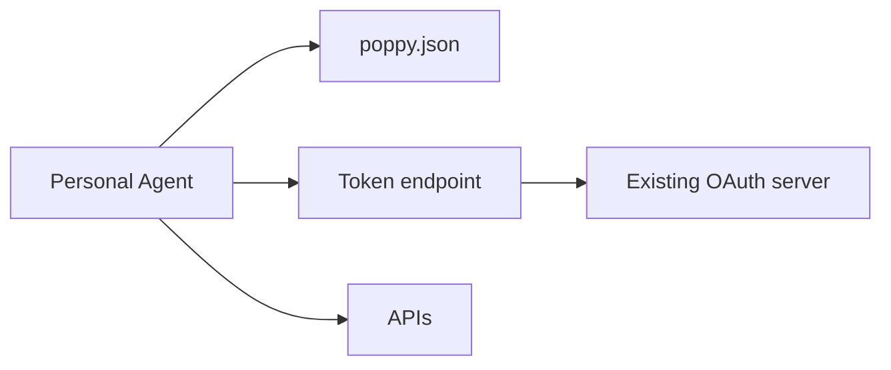

# Design

The design says what the Company will offer, how each part is built on its existing systems, and in
what order. Write it to `plan/design.md` from the template below, then **stop and wait for the
engineer's approval**. Build nothing before that.

## The decisions

Scope decisions are the engineer's. For each one, recommend an option with your reasons, drawing on
the survey, and record what the engineer chose.

**Interfaces** ([3.1](https://personalagentprotocol.org/docs/spec#fields)). Which of these to
offer. A Company can start with one and add more later.

- `openapi`: existing APIs, described in OpenAPI 3.0 or 3.1, accepting DPoP Session Tokens
  ([section 6](https://personalagentprotocol.org/docs/spec#apis)).
- `mcp`: an MCP server accepting Bearer Session Tokens, and DPoP ones if it's new (section 6).
- `conversations`: the Company Agent, through Poppy conversations
  ([section 7](https://personalagentprotocol.org/docs/spec#conversations)).
- `web`: a browser-session endpoint so the Personal Agent's browser joins the Session
  ([section 5](https://personalagentprotocol.org/docs/spec#web-browsing)). Without it, Personal
  Agents browse as ordinary signed-out visitors. A Company offering only `web` without the endpoint
  needs no `auth` at all.

**Sign-in types** ([4.4](https://personalagentprotocol.org/docs/spec#sign-in)). None (signed-out
Sessions only), or any of Direct, Device, and Mediated Sign-In. Direct Sign-In keeps the User's
password with the Company and suits most Companies. Device Sign-In suits Companies that already
offer it. Mediated Sign-In means accepting credentials from Personal Agents, with the duties in
[4.7](https://personalagentprotocol.org/docs/spec#mediated-sign-in) and the
[guides](https://personalagentprotocol.org/docs/guides#company-mediated).

**Scopes** ([4.4](https://personalagentprotocol.org/docs/spec#sign-in)). Which scopes to offer,
usually the OAuth scopes the Company already has (names can't start with `poppy:`), where each one
is described (an OpenAPI description or `auth.scopes`), and which scopes Mediated Sign-In can grant.
See `patterns/scopes.md`.

**Which Personal Agents** ([4.1](https://personalagentprotocol.org/docs/spec#agent-identity)).
Accept any Personal Agent, keep an allowlist or blocklist by `client_id`, or require registration.
Also rate limits on Session creation and on new `client_id` values.

**Lifetimes.** Session Token lifetime (hours, not days, per
[4.2](https://personalagentprotocol.org/docs/spec#starting-sessions); minutes if the Company can't
check sign-in state on each request, per
[4.9](https://personalagentprotocol.org/docs/spec#sign-out)), Account Token lifetime, and how long a
Session lasts. See the [guides](https://personalagentprotocol.org/docs/guides#company-lifetimes).

**Extensions.** Whether to support any, such as
[Operations](https://personalagentprotocol.org/docs/extensions/operations#intro).

The architecture is yours to propose, with the engineer's review. Choose a pattern from
`patterns/` for each component. If none fits, describe your own and say why, and add a **Kit** entry
to `plan/feedback.md`.

## Template for plan/design.md

The first block is read by the validator (`check https://<staging-domain> --design plan/design.md`). Keep its exact shape:

- `domain`: the Company's `organization.domain`.
- `milestones`: in build order, from `foundation`, `interfaces`, `sign-in`, `extensions`.
- `interfaces`: any of `openapi`, `mcp`, `conversations`, `web`. `web` means a
  `browser_session_endpoint`.
- `sign_in`: any of `direct`, `device`, `mediated`. Empty for signed-out only.
- `extensions`: extension names, such as `operations`. Usually empty.

````markdown
# Poppy design: <Company>

Status: <draft | approved by <engineer> on <YYYY-MM-DD>>

```json poppy-design
{
    "domain": "example.com",
    "milestones": ["foundation", "interfaces", "sign-in"],
    "interfaces": ["openapi", "mcp", "conversations", "web"],
    "sign_in": ["direct", "device", "mediated"],
    "extensions": []
}
```

## 1. Scope

| Decision                | Recommendation and why | Engineer's decision |
| ----------------------- | ---------------------- | ------------------- |
| Interfaces              |                        |                     |
| Sign-in types           |                        |                     |
| Scopes and descriptions |                        |                     |
| Scopes per sign-in type |                        |                     |
| Which Personal Agents   |                        |                     |
| Rate limits             |                        |                     |
| Session Token lifetime  |                        |                     |
| Account Token lifetime  |                        |                     |
| Extensions              |                        |                     |

<Anything explicitly out of scope for now, and why.>

## 2. Architecture

| Component                                        | Pattern (from patterns/) | Why | Existing system it builds on |
| ------------------------------------------------ | ------------------------ | --- | ---------------------------- |
| poppy.json                                       |                          |     |                              |
| Token endpoint                                   |                          |     |                              |
| Verifying Personal Agents                        |                          |     |                              |
| DPoP verification                                |                          |     |                              |
| Replay cache (APIs: shared, per server, or none) |                          |     |                              |
| Session and token records                        |                          |     |                              |
| APIs (OpenAPI)                                   |                          |     |                              |
| MCP                                              |                          |     |                              |
| Conversations                                    |                          |     |                              |
| Web browsing                                     |                          |     |                              |
| Sign-in and consent pages                        |                          |     |                              |
| Scope enforcement                                |                          |     |                              |
| Account settings                                 |                          |     |                              |

<Remove rows that are out of scope.>



<Replace with the real components. Mark which ones exist today and which are new.>

## 3. Mapping

### Scopes

| Scope | Description | Existing permissions it grants | Mediated Sign-In |
| ----- | ----------- | ------------------------------ | ---------------- |
|       |             |                                |                  |

### Sessions and Account Tokens

<Where each record lives and which existing record it maps to. See patterns/session-records.md.>

| Poppy record  | Fields                                                                       | Stored in | Maps to existing |
| ------------- | ---------------------------------------------------------------------------- | --------- | ---------------- |
| Session       | Session Key thumbprint, `client_id`, User ID, account (if signed in), expiry |           |                  |
| Account Token | `client_id`, User ID, account, scopes, expiry                                |           |                  |
| Session Token | Session, scopes, key binding or `resource`, expiry                           |           |                  |

## 4. Plan

| Milestone  | What it delivers | Validator command                                                                   | Manual checks |
| ---------- | ---------------- | ----------------------------------------------------------------------------------- | ------------- |
| foundation |                  | `node <skill-dir>/validate/index.ts check https://<staging> --milestone foundation` |               |
| interfaces |                  | `node <skill-dir>/validate/index.ts check https://<staging> --milestone interfaces` |               |
| sign-in    |                  | `node <skill-dir>/validate/index.ts check https://<staging> --milestone sign-in`    |               |

Staging domain: <host>. Test identity hosted at: <HTTPS base URL>.

## 5. Open questions and risks

- <Question or risk, who answers it, and by when.>
````

Keep the design current. When something changes during the build, update it and tell the engineer.
