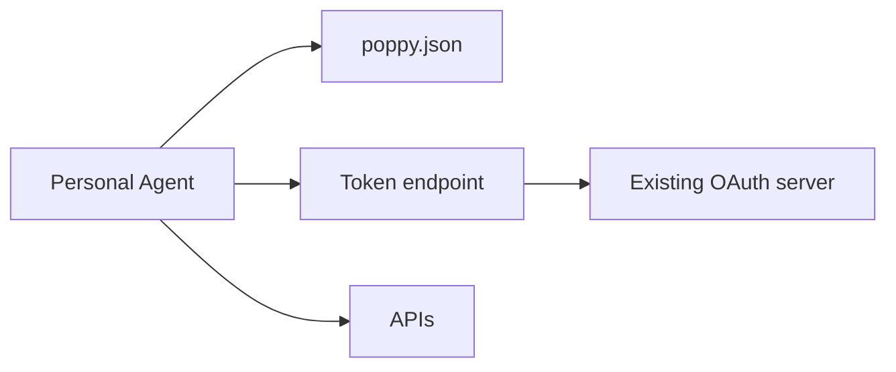

# Design

The design says what the Company will offer, how each part is built on its existing systems, and in
what order. Write it to `plan/design.md` from the template below, then **stop and wait for the
engineer's approval**. Build nothing before that.

## The decisions

Scope decisions are the engineer's. For each one, recommend an option with your reasons, drawing on
the survey, and record what the engineer chose.

**Interfaces** ([3.1](https://personalagentprotocol.org/docs/0.3/spec#fields)). Which of these to
offer. A Company can start with one and add more later.

- `openapi`: existing APIs, described in OpenAPI 3.0 or 3.1, accepting the Session header and the
  Company's access tokens ([section 7](https://personalagentprotocol.org/docs/0.3/spec#apis)).
- `mcp`: an MCP server accepting the Company's access tokens issued for its `url`, as MCP
  authorization already requires. It MAY ignore the Session header, but then its calls belong to no
  Session and it can't take signed-out calls from Personal Agents (section 7).
- `conversations`: the Company Agent, through Poppy conversations
  ([section 8](https://personalagentprotocol.org/docs/0.3/spec#conversations)).
- `web`: a browser-session endpoint so the Personal Agent's browser joins the Session
  ([section 6](https://personalagentprotocol.org/docs/0.3/spec#web-browsing)). Without it, Personal
  Agents browse as ordinary signed-out visitors. A Company offering only `web` without the endpoint
  needs no `auth` at all.

**Sign-in types** ([5.4](https://personalagentprotocol.org/docs/0.3/spec#sign-in)). None (signed-out
Sessions only), or any of Direct, Device, and Mediated Sign-In. Direct Sign-In keeps the User's
password with the Company and suits most Companies. Device Sign-In suits Companies that already
offer it. Mediated Sign-In is an extension that means accepting credentials from Personal Agents,
with the duties in the [extension](https://personalagentprotocol.org/docs/0.3/extensions/mediated-sign-in) and the
[guides](https://personalagentprotocol.org/docs/0.3/guides#company-mediated). It is transitional: the
protocol plans to remove it, on a date set when version 1.0 is published. Choose it only as a bridge
to Direct or Device Sign-In, and record when you plan to add those.

**Scopes** ([4.7](https://personalagentprotocol.org/docs/0.3/spec#scopes)). Which scopes to offer,
usually the OAuth scopes the Company already has, where each one
is described (an OpenAPI description or `auth.scopes`), and which scopes Mediated Sign-In can grant.
See `patterns/scopes.md`.

**Which Personal Agents** ([4.1](https://personalagentprotocol.org/docs/0.3/spec#agent-identity)).
Accept any Personal Agent, keep an allowlist or blocklist by `client_id`, or require registration.
Also rate limits on Session creation and on new `client_id` values.

**Access tokens** ([4.5](https://personalagentprotocol.org/docs/0.3/spec#access-tokens)). Bearer or
DPoP-bound, as for any OAuth client: DPoP is the Company's choice, and Personal Agents should
support it. Which services, if any, accept only tokens issued for them, by publishing RFC 9728
protected resource metadata. MCP servers always do.

**Lifetimes.** The acceptance window for a Session JWT's `iat`, such as one minute
([5.3](https://personalagentprotocol.org/docs/0.3/spec#session-verification)), and the largest
delegation lifetime you accept, up to 24 hours
([Delegated keys](https://personalagentprotocol.org/docs/0.3/spec#delegated-keys)). The lifetime of
access tokens, refresh tokens, and Sessions, how long to remember ended Sessions, and the sign-out
checks in [5.5](https://personalagentprotocol.org/docs/0.3/spec#ending-sessions). See the
[guides](https://personalagentprotocol.org/docs/0.3/guides#company-lifetimes).

**Operations.** Which actions, if any, need the User's approval before you perform them
([Operations 1](https://personalagentprotocol.org/docs/0.3/extensions/operations#intro)). Build the
optional `operations` version 2 extension in the extensions milestone.

**Extensions.** Whether to define any of the Company's own
([3.3](https://personalagentprotocol.org/docs/0.3/spec#extensions)). Usually none.

The architecture is yours to propose, with the engineer's review. Choose a pattern from
`patterns/` for each component. If none fits, describe your own and say why, and add a **Kit** entry
to `plan/feedback.md`.

## Template for plan/design.md

The first block is read by the validator (`check https://<staging-domain> --design plan/design.md`). Keep its exact shape:

- `domain`: the Company's `organization.domain`.
- `milestones`: in build order, from `foundation`, `interfaces`, `sign-in`, `extensions`.
- `interfaces`: any of `openapi`, `mcp`, `conversations`, `web`. `web` means a
  `browser_session_endpoint`.
- `sign_in`: any of `direct`, `device`. Empty for signed-out only, or Mediated Sign-In only.
  Mediated Sign-In goes in `extensions` as `mediated-sign-in`.
- `extensions`: extension names, such as `operations` or `example.com/gift-wrap`. Empty when none are needed.

````markdown
# Poppy design: <Company>

Status: <draft | approved by <engineer> on <YYYY-MM-DD>>

```json poppy-design
{
    "domain": "example.com",
    "milestones": ["foundation", "interfaces", "sign-in"],
    "interfaces": ["openapi", "mcp", "conversations", "web"],
    "sign_in": ["direct", "device"],
    "extensions": []
}
```

## 1. Scope

| Decision                | Recommendation and why | Engineer's decision |
| ----------------------- | ---------------------- | ------------------- |
| Interfaces              |                        |                     |
| Sign-in types           |                        |                     |
| Scopes and descriptions |                        |                     |
| Scopes per sign-in type |                        |                     |
| Which Personal Agents   |                        |                     |
| Rate limits             |                        |                     |
| Access tokens (DPoP?)   |                        |                     |
| Session JWT window      |                        |                     |
| Access token lifetime   |                        |                     |
| Refresh token lifetime  |                        |                     |
| Extensions              |                        |                     |

<Anything explicitly out of scope for now, and why.>

## 2. Architecture

| Component                                              | Pattern (from patterns/) | Why | Existing system it builds on |
| ------------------------------------------------------ | ------------------------ | --- | ---------------------------- |
| poppy.json and protected resource metadata             |                          |     |                              |
| OAuth server and token endpoint                        |                          |     |                              |
| Verifying Personal Agents                              |                          |     |                              |
| Session header verification                            |                          |     |                              |
| Session JWT replay cache (shared, per server, or none) |                          |     |                              |
| Session records                                        |                          |     |                              |
| APIs (OpenAPI)                                         |                          |     |                              |
| MCP                                                    |                          |     |                              |
| Conversations                                          |                          |     |                              |
| Web browsing                                           |                          |     |                              |
| Sign-in and consent pages                              |                          |     |                              |
| Scope enforcement                                      |                          |     |                              |
| Account settings                                       |                          |     |                              |

<Remove rows that are out of scope.>



<Replace with the real components. Mark which ones exist today and which are new.>

## 3. Mapping

### Scopes

| Scope | Description | Existing permissions it grants | Mediated Sign-In |
| ----- | ----------- | ------------------------------ | ---------------- |
|       |             |                                |                  |

### Sessions and tokens

<Where each record lives and which existing record it maps to. See patterns/session-records.md.>

| Record        | Fields                                                                                        | Stored in | Maps to existing |
| ------------- | --------------------------------------------------------------------------------------------- | --------- | ---------------- |
| Session       | `client_id` and `sid` (the key), User ID, Agent ID, account it has used, ended or not         |           |                  |
| Refresh token | `client_id`, account, scopes, expiry                                                          |           |                  |
| Access token  | `client_id`, account, scopes, `resource` (if any), DPoP key (if bound), refresh token, expiry |           |                  |

## 4. Plan

| Milestone  | What it delivers | Validator command                                                                   | Manual checks |
| ---------- | ---------------- | ----------------------------------------------------------------------------------- | ------------- |
| foundation |                  | `node <skill-dir>/validate/index.ts check https://<staging> --milestone foundation` |               |
| interfaces |                  | `node <skill-dir>/validate/index.ts check https://<staging> --milestone interfaces` |               |
| sign-in    |                  | `node <skill-dir>/validate/index.ts check https://<staging> --milestone sign-in`    |               |

Staging domain: <host>. Test identity hosted at: <HTTPS base URL>.

## 5. Open questions and risks

- <Question or risk, who answers it, and by when.>
````

Keep the design current. When something changes during the build, update it and tell the engineer.
